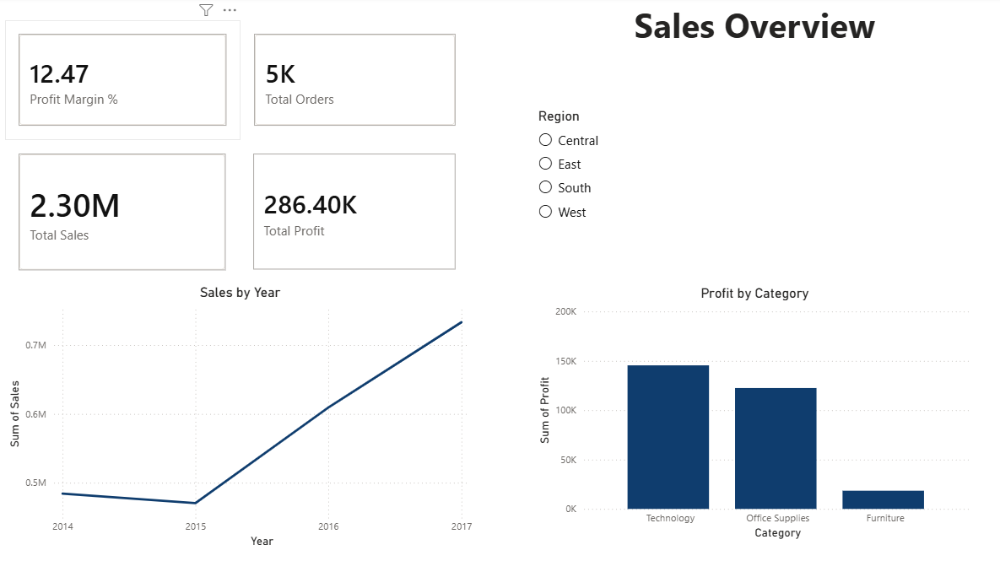
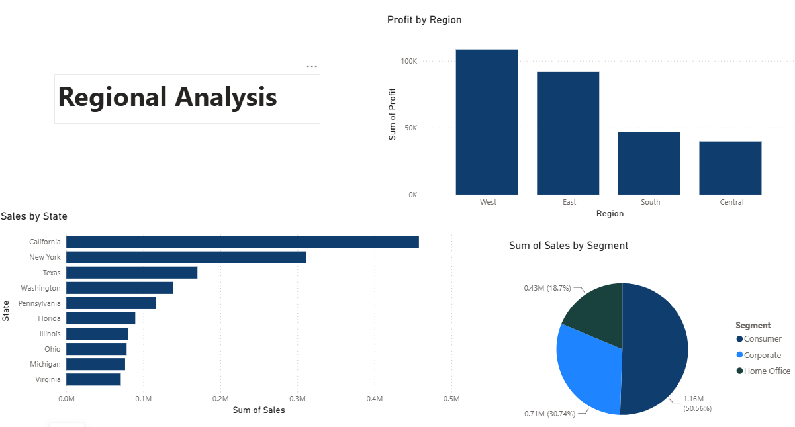
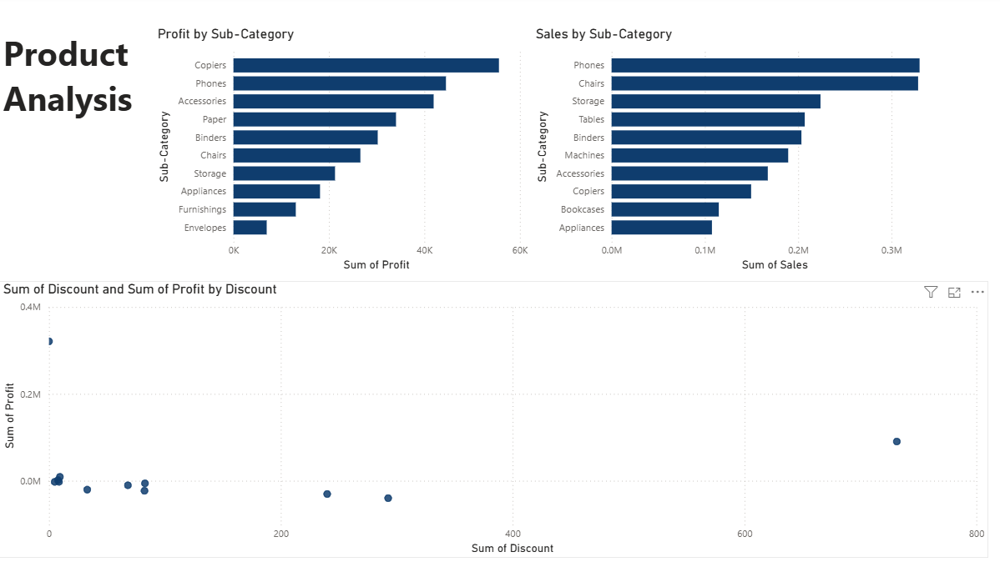

# Superstore Sales Dashboard (Power BI)

A 3-page interactive Power BI dashboard analyzing $2.30M in sales and $286K in profit for a retail superstore, covering sales trends, regional performance and product profitability.

## Dashboard Preview




## Business Questions
- How are sales and profit performing overall, and how have they changed over time?
- Which regions, states and customer segments drive results?
- Which categories and sub-categories perform best, and how do discounts affect profit?

## Dataset
- Source: [Kaggle - Superstore Dataset](https://www.kaggle.com/datasets/vivek468/superstore-dataset-final)
- Key fields: Order Date, Ship Date, Region, State, City, Segment, Category, Sub-Category, Sales, Quantity, Discount, Profit
- Data check: Power Query column quality showed every column 100% valid, with no errors or empty values.

## Dashboard Pages
1. **Sales Overview:** KPI cards (total sales, total profit, profit margin, total orders), sales by category, sales trend over time, and a region slicer that filters every visual.
2. **Regional Analysis:** top 10 states by sales, profit by region, and sales by customer segment.
3. **Product Analysis:** sales and profit by sub-category, and a discount vs. profit scatter plot.

## DAX Measures
```
Profit Margin % = DIVIDE(SUM('Sample - Superstore'[Profit]), SUM('Sample - Superstore'[Sales])) * 100
Total Orders = DISTINCTCOUNT('Sample - Superstore'[Order ID])
```

## Key Findings
- The business made **$2.30M in sales and $286.4K in profit**, a **12.47% profit margin**, across about 5,000 orders.
- **Technology** is the top category by sales.
- Sales dipped in 2015, then recovered and grew in the following years.
- The **West** is the most profitable region, and **California** is the top state by sales.
- The **Consumer** segment is the largest by sales.
- **Discounts above roughly 20% turn average profit negative.** Average profit is positive at 0-20% discount and negative from 30% upward, with the largest average loss (about $300 per line item) at a 50% discount. This was checked in Python by grouping the data by discount level and averaging profit.

## Recommendations
- Review the discounting policy and consider capping discounts at around 20%, since deeper discounts lose money on average.
- Use the Product Analysis page to find sub-categories with low or negative profit and review their pricing and discounts.

## How to Open
Download `Superstore.pbix` and open it in Power BI Desktop (Windows). Use the region slicer on page 1 to filter the dashboard.

## Tools Used
Power BI, DAX, Power Query, Python (pandas) for the discount analysis

## Author
Shaheer Samad Waien | [LinkedIn](https://linkedin.com/in/shaheer-waien) | shaheerwaien@hotmail.com
